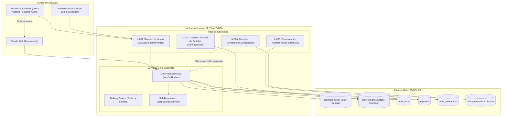

# Documento de Arquitectura de Software (SAD) — ZYRO Omnicanal (Alcance Refinado MVP)
**Metodología:** PolkDev | **Enfoque:** Spec as a Skill  
**Proyecto:** ZYRO — Comercio Electrónico Omnicanal  
**Rama:** `feature/zyro-omnicanal`  
**Fase:** F1 — Arquitectura Ajustada MVP  
**Estado:** Documento de Arquitectura Consolidado para F2  

---

## 1. Visión y Principios de Diseño del MVP

La arquitectura para esta fase adopta un enfoque **pragmático, monolítico modular y no destructivo**, diseñado para entregar cuatro módulos funcionales demostrables sobre el framework Laravel 12 existente sin introducir microservicios, brokers de mensajería externos ni sobrecargas innecesarias.



---

## 2. Decisiones Arquitectónicas Adaptadas al MVP

### 2.1 Reutilización del Mecanismo Transaccional de Inventario
- **Inventario Compartido Único:** Todas las operaciones de venta (web, presencial o asistida por WhatsApp) leen y descuentan directamente sobre `products.stock`.
- **Cero Lógica Duplicada:** El registro manual de ventas en el panel administrativo invoca la misma lógica transaccional atómica:
  ```php
  DB::transaction(function () use ($items, $orderData, $adminUser) {
      foreach ($items as $item) {
          $product = Product::query()
              ->where('id', $item['product_id'])
              ->where('is_active', true)
              ->lockForUpdate()
              ->firstOrFail();

          if ($product->stock < $item['quantity']) {
              throw new InsufficientStockException("Stock insuficiente para {$product->name}.");
          }

          $product->decrement('stock', $item['quantity']);
      }
      // Creación del pedido unificado
  });
  ```
- **Protección contra Concurrencia:** Bloqueo pesimista `lockForUpdate()`, validación estricta de cantidades positivas ($qty \ge 1$) y prevención de stock negativo.

---

### 2.2 Unificación de Pedidos y Modelo de Datos
- **Entidad `orders` Ampliada:** Se agregan columnas no destructivas:
  - `channel_origin`: Enum o string con valores `'web'`, `'whatsapp'`, `'punto_fisico'`.
  - `created_by`: Clave foránea opcional a `users` para registrar el operador que asentó la venta asistida o presencial.
  - `payment_method` y `payment_status`: Reflejados en el pedido para visualización ágil en listados administrativos.
- **Continuidad sin Duplicación:** Si un cliente inicia una compra por WhatsApp y luego acude al local en Guayaquil a pagar o retirar, el operador consulta el pedido por su número (`ZYR-XXXX`) y actualiza su estado. No se genera una nueva orden.

---

### 2.3 Arquitectura de Comunicación Asistida (`wa.me`)
- **Generación Dinámica sin APIs Externas:** En lugar de implementar la infraestructura de Meta Cloud API para esta fase, se utiliza un generador de enlaces universales `wa.me` parametrizados con el número de teléfono configurado en `config/shop.php` (`WHATSAPP_NUMBER`):
  - En tarjeta/detalle de producto:  
    `https://wa.me/{phone}?text={urlencode("Hola, quiero consultar por la chompa " . $product->name . " en talla " . $size . ". Referencia: " . $product->slug)}`
  - En detalle de pedido de cliente:  
    `https://wa.me/{phone}?text={urlencode("Hola ZYRO, quisiera consultar sobre mi pedido " . $order->order_number)}`
- **Bitácora de Interacciones del Pedido (`order_interactions`):** Sub-módulo para asentar en cada pedido las consultas telefónicas, acuerdos de pago o novedades de entrega, registrando operador, canal, tipo de contacto y notas.

---

### 2.4 Arquitectura del Módulo de Cambios y Devoluciones
- **Flujo de Tres Estados:**  
  `Recibida (received)` $\longrightarrow$ `En revisión (in_review)` $\longrightarrow$ `Resuelta (resolved / rejected)`.
- **Aislamiento de Stock en Inspección:** Las prendas que retornan del cliente ingresan a un estado de cuarentena (`inspected_condition = 'pendiente'`). No aumentan el stock vendible en `products.stock`.
- **Reincorporación Explícita:** Solo cuando el dictamen técnico determine que la prenda está intacta (`inspected_condition = 'optimo_con_etiquetas'`) y el administrador confirme el reingreso, se ejecuta un incremento seguro:
  ```php
  $product->increment('stock', $itemQuantity);
  ```
- Si se aprueba un cambio de prenda, la entrega del producto sustituto descuenta su respectivo stock en la misma transacción.

---

## 3. Matriz de Componentes del Sistema

| Módulo / Capacidad | Estado en la Aplicación | Responsabilidad Técnica |
| :--- | :---: | :--- |
| **Tienda Web y Carrito** | `[EXISTENTE]` | Venta autoservicio online mediante [`CartController`](file:///C:/xampp/htdocs/ZYRO/app/Http/Controllers/CartController.php) y [`CheckoutService`](file:///C:/xampp/htdocs/ZYRO/app/Services/CheckoutService.php). |
| **K-001: Registrar Venta Manual** | `[NUEVO - MVP]` | Formulario administrativo `/admin/ventas/crear` con descuento atómico directo en `products.stock`. |
| **K-002: Gestión Unificada de Pedidos** | `[NUEVO - MVP]` | Filtros por canal (`web`, `whatsapp`, `punto_fisico`), fecha y estado en `/admin/pedidos`. |
| **K-003: Botones wa.me y Bitácora** | `[NUEVO - MVP]` | Enlaces dinámicos en vistas Blade y tabla `order_interactions` asociada al pedido. |
| **K-004: Cambios y Devoluciones** | `[NUEVO - MVP]` | Autoservicio del cliente en `/mi-cuenta/pedidos` y gestión en `/admin/solicitudes`. |
| **Múltiples Bodegas Físicas** | `[DIFERIDO]` | Excluido de este MVP; se utiliza inventario central consolidado. |
| **Meta Cloud API Oficial** | `[DIFERIDO]` | Excluido de este MVP; reemplazado por enlaces universales `wa.me`. |
| **Cobros Reales PayPhone / Deuna** | `[DIFERIDO]` | Excluido de este MVP; se registran métodos y estados compatibles. |
| **CRM Avanzado Multi-agente** | `[DIFERIDO]` | Excluido de este MVP; se utiliza la bitácora `order_interactions`. |
