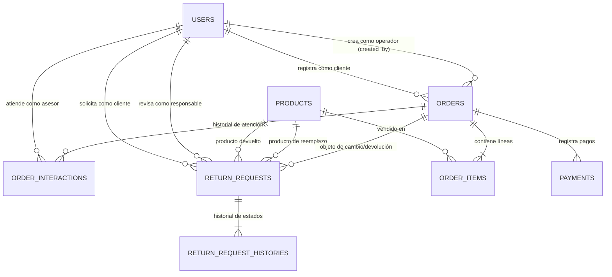

# Diseño del Modelo de Datos — ZYRO Omnicanal (Alcance Refinado MVP)
**Metodología:** PolkDev | **Enfoque:** Spec as a Skill  
**Proyecto:** ZYRO — Comercio Electrónico Omnicanal  
**Motor:** MySQL 8.0 (InnoDB)  
**ORM:** Laravel 12.x Eloquent  
**Fase:** F1 — Modelo de Datos Refinado para F2  
**Estado:** Especificación de Esquema Consolidada  

---

## 1. Estrategia de Migraciones Mínimas No Destructivas

Para dar cumplimiento a la directriz de **no romper la aplicación existente, no inventar sobreingeniería y requerir el menor número de cambios posibles**, este diseño se compone estrictamente de:

1. **Una migración de alteración no destructiva** sobre la tabla [`orders`](file:///C:/xampp/htdocs/ZYRO/database/migrations/2026_10_18_184534_create_orders_table.php).
2. **Tres migraciones de creación de tablas auxiliares** para dar soporte a la bitácora de atención y la gestión de cambios y devoluciones.
3. **Cero alteraciones a [`products`](file:///C:/xampp/htdocs/ZYRO/database/migrations/2026_10_18_184534_create_products_table.php):** El stock se sigue gestionando en la columna `products.stock` directamente, garantizando compatibilidad absoluta con todos los tests existentes ([`OrderTest`](file:///C:/xampp/htdocs/ZYRO/tests/Feature/OrderTest.php), [`PaymentTest`](file:///C:/xampp/htdocs/ZYRO/tests/Feature/PaymentTest.php), [`CatalogTest`](file:///C:/xampp/htdocs/ZYRO/tests/Feature/CatalogTest.php)).

---

## 2. Diagrama Entidad-Relación del MVP



---

## 3. Especificación Detallada de Migraciones

### Migración 1: `add_channel_and_operator_to_orders_table`
Agrega trazabilidad de canal de origen, operador responsable y resumen de pago a la tabla existente `orders`.

```php
Schema::table('orders', function (Blueprint $table) {
    // Canal de procedencia: web (autoservicio), whatsapp (asistida), punto_fisico (presencial)
    $table->string('channel_origin', 32)
        ->default('web')
        ->after('delivery_method');

    // Operador administrativo que registró la venta (null para compras web directas)
    $table->foreignId('created_by')
        ->nullable()
        ->after('user_id')
        ->constrained('users')
        ->nullOnDelete();

    // Snapshot ágil para visualización y filtros en el panel
    $table->string('payment_method', 50)->nullable()->after('status');
    $table->string('payment_status', 32)->default('pending')->after('payment_method');

    $table->index(['channel_origin', 'status']);
    $table->index('created_at');
});
```

*Reversión (`down`):*
```php
Schema::table('orders', function (Blueprint $table) {
    $table->dropForeign(['created_by']);
    $table->dropIndex(['channel_origin', 'status']);
    $table->dropIndex(['created_at']);
    $table->dropColumn(['channel_origin', 'created_by', 'payment_method', 'payment_status']);
});
```

---

### Migración 2: `create_order_interactions_table`
Almacena el historial de atención y seguimiento omnicanal vinculado a cada pedido.

```php
Schema::create('order_interactions', function (Blueprint $table) {
    $table->id();
    $table->foreignId('order_id')->constrained('orders')->cascadeOnDelete();
    $table->foreignId('user_id')->nullable()->constrained('users')->nullOnDelete(); // Operador que atendió
    $table->string('channel', 32); // whatsapp, punto_fisico, llamada, email
    $table->string('interaction_type', 60); // consulta_talla, coordinacion_entrega, comprobante_pago, reclamo, otro
    $table->text('description');
    $table->text('follow_up_notes')->nullable();
    $table->timestamps();

    $table->index(['order_id', 'created_at']);
});
```

*Reversión (`down`):*
```php
Schema::dropIfExists('order_interactions');
```

---

### Migración 3: `create_return_requests_table`
Módulo de cambios y devoluciones para clientes y administración.

```php
Schema::create('return_requests', function (Blueprint $table) {
    $table->id();
    $table->string('request_number', 50)->unique(); // Ej: DEV-2026-0001
    $table->foreignId('order_id')->constrained('orders')->restrictOnDelete();
    $table->foreignId('user_id')->constrained('users')->restrictOnDelete(); // Cliente solicitante
    $table->foreignId('order_item_id')->nullable()->constrained('order_items')->nullOnDelete();
    $table->foreignId('product_id')->constrained('products')->restrictOnDelete();
    $table->string('size', 20)->nullable();
    
    // Motivo y descripción del cliente
    $table->string('reason', 150);
    $table->text('problem_description');
    $table->string('requested_solution', 50); // cambio_talla, cambio_color, devolucion_dinero, garantia_defecto
    
    // Estados: recibida -> en_revision -> resuelta / rechazada
    $table->string('status', 32)->default('recibida');
    
    // Peritaje técnico e inspección física
    $table->foreignId('reviewer_id')->nullable()->constrained('users')->nullOnDelete();
    $table->string('inspected_condition', 50)->default('pendiente'); 
    // pendiente, optimo_con_etiquetas, usado_limpio, defecto_fabrica, no_apto
    
    // Solución administrativa asignada
    $table->foreignId('replacement_product_id')->nullable()->constrained('products')->nullOnDelete();
    $table->string('replacement_size', 20)->nullable();
    $table->text('admin_decision')->nullable();
    
    // Control estricto de reincorporación a inventario
    $table->boolean('is_restocked')->default(false);
    $table->timestamp('restocked_at')->nullable();
    $table->timestamp('resolved_at')->nullable();
    $table->timestamps();

    $table->index(['status', 'created_at']);
    $table->index(['order_id', 'user_id']);
});
```

*Reversión (`down`):*
```php
Schema::dropIfExists('return_requests');
```

---

### Migración 4: `create_return_request_histories_table`
Trazabilidad de cambios de estado y notas internas de las solicitudes de cambio.

```php
Schema::create('return_request_histories', function (Blueprint $table) {
    $table->id();
    $table->foreignId('return_request_id')->constrained('return_requests')->cascadeOnDelete();
    $table->foreignId('changed_by')->nullable()->constrained('users')->nullOnDelete();
    $table->string('from_status', 32);
    $table->string('to_status', 32);
    $table->text('note')->nullable();
    $table->timestamps();

    $table->index('return_request_id');
});
```

*Reversión (`down`):*
```php
Schema::dropIfExists('return_request_histories');
```

---

## 4. Comparativa de Migraciones: Especificación Original vs. Alcance Refinado

| Aspecto | Especificación Inicial F1 | Alcance Refinado MVP (Aprobado) |
| :--- | :--- | :--- |
| **Tablas Nuevas Creadas** | 10 tablas (almacenes, variantes, stocks, kárdex, expedientes, webhooks). | **3 tablas auxiliares** (`order_interactions`, `return_requests`, `return_request_histories`). |
| **Alteración a `products`** | Desacoplamiento de stock a tabla externa con triggers/observers síncronos. | **Cero alteraciones.** El campo `products.stock` se mantiene como fuente única de verdad. |
| **Backfill de Datos** | Complejo script de conversión de tallas JSON a filas relacionales. | **No requerido.** Cero riesgo de corrupción de datos. |
| **Riesgo en Rollback** | Alto (requería borrar llaves foráneas múltiples y tablas intermedias). | **Nulo.** Reversión limpia en 4 `dropTable` simples. |
