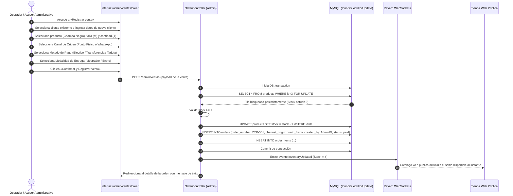
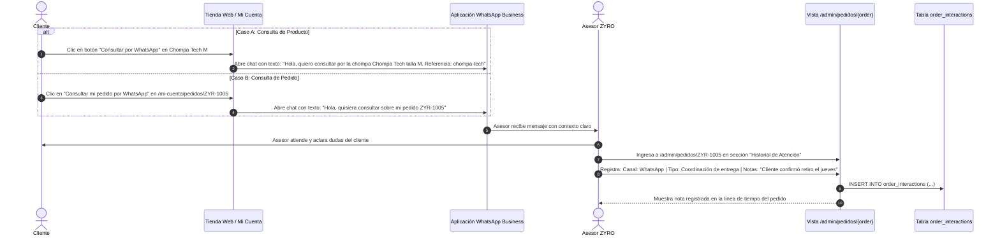
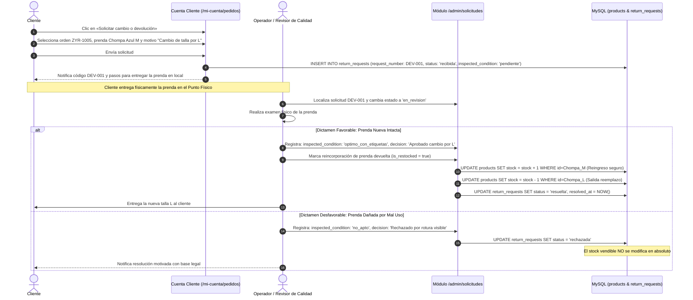

# Flujos de Usuario e Interacción — ZYRO Omnicanal (Alcance Refinado MVP)
**Metodología:** PolkDev | **Enfoque:** Spec as a Skill  
**Proyecto:** ZYRO — Comercio Electrónico Omnicanal  
**Fase:** F1 — Especificación de Flujos Ajustada para F2  
**Estado:** Documento de Flujos Consolidado  

---

## 1. Recorrido 1: Registro de Ventas Manuales por Canal (K-001)

Ilustra la creación de una venta directa (presencial en Guayaquil o asistida por WhatsApp) desde el panel administrativo, reutilizando el inventario central con bloqueo transaccional.



---

## 2. Recorrido 2: Gestión Unificada y Continuación de Compra Multicanal (K-002)

Ilustra la continuidad de una venta asistida iniciada en WhatsApp que el cliente culmina pagando o retirando en el Punto Físico de Guayaquil, manteniendo el mismo número de pedido sin duplicarlo.

```mermaid
sequenceDiagram
    autonumber
    actor C as Cliente
    actor Asesor as Asesor WhatsApp
    actor Cajero as Cajero Punto Físico
    participant Panel as Panel Administrativo de Pedidos
    participant DB as Base de Datos MySQL

    C->>Asesor: Solicita compra asistida por WhatsApp
    Asesor->>Panel: Registra pedido en /admin/ventas con canal 'whatsapp' y estado 'pending_approval'
    Panel->>DB: Genera orden ZYR-6020 y descuenta stock
    Asesor-->>C: "Tu pedido ZYR-6020 está reservado. Puedes pagarlo y retirarlo en nuestro local de Guayaquil."
    Note over C,Cajero: Cliente acude al Punto Físico en Guayaquil
    C->>Cajero: "Vengo a retirar mi pedido ZYR-6020"
    Cajero->>Panel: Accede a /admin/pedidos y busca "ZYR-6020"
    Panel->>DB: Consulta la orden ZYR-6020 existente
    Panel-->>Cajero: Muestra detalle del pedido, prendas y saldo pendiente
    Cajero->>C: Recibe el pago en efectivo o comprobante
    Cajero->>Panel: Marca orden ZYR-6020 como 'paid' y entrega producto
    Panel->>DB: UPDATE orders SET status='paid', paid_at=NOW() WHERE id=6020
    Note over Panel,DB: No se crea ningún pedido nuevo; se preserva ZYR-6020 íntegro
    Panel-->>Cajero: Confirma actualización exitosa
```

---

## 3. Recorrido 3: Comunicación Omnicanal con Enlaces Dinámicos y Bitácora (K-003)

Ilustra la asistencia mediante enlaces parametrizados de WhatsApp en producto y pedido, y el registro de la interacción en la bitácora del pedido.



---

## 4. Recorrido 4: Solicitud de Cambio/Devolución e Inspección Administrativa (K-004)

Ilustra el autoservicio del cliente para solicitar cambio o devolución conforme al Art. 45 de la LODC Ecuador, la inspección técnica en el punto físico y el control estricto de reincorporación al inventario.


